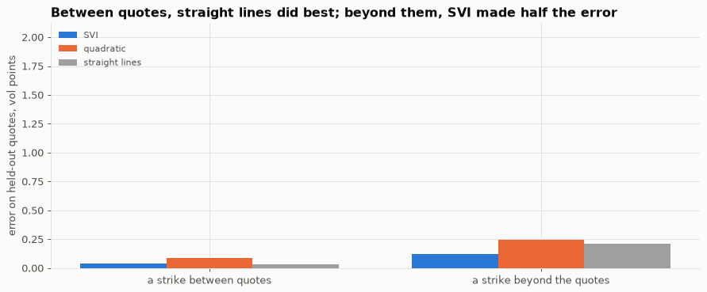
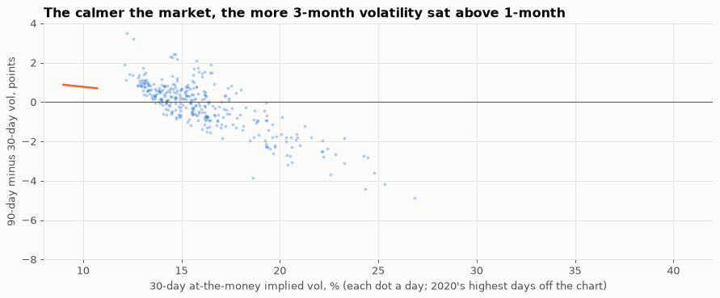
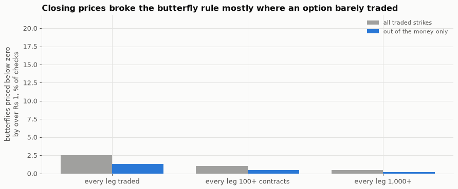
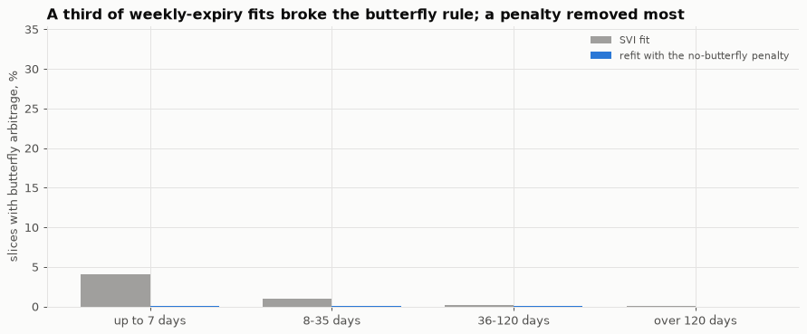
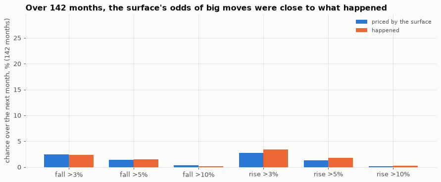
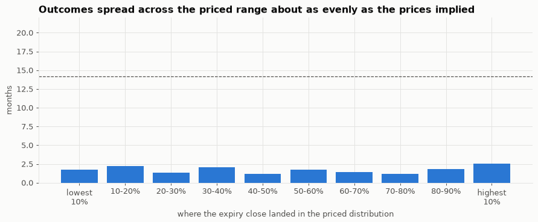
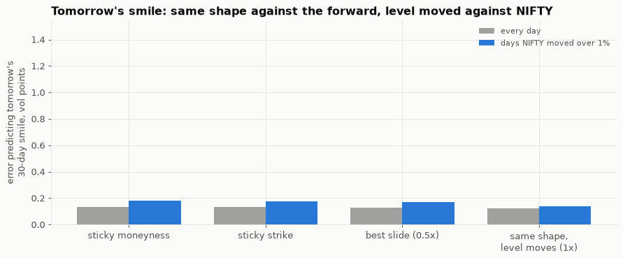
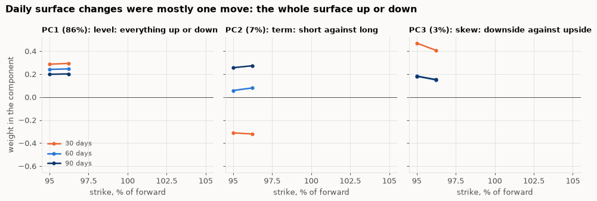
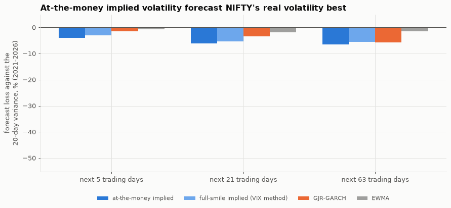
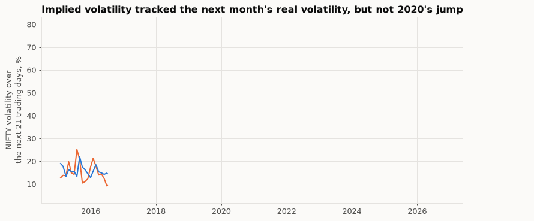

# Implied Volatility Surface

[](https://github.com/Dhirajdas18/implied-vol-surface/actions/workflows/ci.yml)
[](https://dhirajdas18.github.io/implied-vol-surface/)

The NIFTY implied volatility surface, every strike and expiry on every trading day from 2015 to
2026, built from NSE's daily F&O bhavcopy, with stock option surfaces to follow. Only derived
results (fitted parameters and summaries) are committed; the raw NSE data stays local.

**Live surface lab: [dhirajdas18.github.io/implied-vol-surface](https://dhirajdas18.github.io/implied-vol-surface/)**,
pick a date and an expiry and see the 3D surface you can turn, every expiry's smile, the chosen one against the market, the term
structure of at-the-money volatility and skew, and the no-arbitrage flags; updated when the
studies are rerun locally.

## Features

- [x] Building the surface: forwards, out-of-the-money quotes, SVI per expiry
- [x] No-arbitrage checks on quotes and fits
- [x] Risk-neutral densities and tail probabilities against realised moves
- [x] Surface dynamics: sticky strike against sticky delta, principal components
- [x] Forecasting realised volatility: implied by maturity against GARCH and India VIX
- [ ] Stock option surfaces against NIFTY
- [ ] Does the skew or term structure predict returns or crashes

## Findings

### 1. Between quoted strikes, straight lines beat SVI; beyond them, SVI made half the error

<a href="docs/img/holdout.png"><picture><source media="(prefers-reduced-motion: reduce)" srcset="docs/img/holdout.png"></picture></a>

<a href="docs/img/term_structure.png"><picture><source media="(prefers-reduced-motion: reduce)" srcset="docs/img/term_structure.png"></picture></a>

Each day's forward for each expiry comes from put-call parity at the strikes nearest the money;
quotes are the out-of-the-money options that traded that day, turned into Black-76 implied
volatility (closing prices, 6.5% rate). Every expiry with at least five quotes gets an SVI fit:
18,345 slices on 2,927 days, 2015–2026. For the hold-out test, every slice with at least ten quotes
(17,362) is fitted three ways without some of its quotes and scored on them: every third interior
quote (a strike between quotes) or the two lowest and two highest strikes (beyond the quotes).

- **Parity forwards matched the futures.** Against the same expiry's futures settle, the parity
  forward differed by a median 2.0 bp (90th percentile 6.4 bp); the futures settle was needed for
  only 0.5% of slices.
- **Between quotes, the quotes themselves were the best curve.** Straight lines between neighbouring
  quotes missed a held-out quote by a median 0.26 vol points, SVI by 0.35 and a quadratic by 0.70;
  lines were best for 66% of slices.
- **Beyond the quotes, SVI was the only safe guess.** It missed the outer strikes by 0.97 points
  against 1.75 for flat lines and 2.02 for a quadratic, and was best for 69% of slices; for weekly
  expiries the quadratic missed by 5.85.
- **Puts were dearer on 98.7% of slices, and the skew faded with maturity.** The at-the-money slope
  of volatility against log-moneyness went from −0.47 at 8–14 days to −0.19 beyond 200 days; within a
  day it fell with maturity to a median power of −0.30 (ten times the maturity, about half the skew).
- **The term structure tilted with the level.** 90-day volatility sat 0.70 points above 30-day on
  the calmest third of days and 0.91 below on the most volatile third, where it was inverted by over
  a point on 47% of days (thirds cut on all days; correlation −0.70). India VIX, computed from all
  strikes, was above 30-day at-the-money volatility on 97% of days, by a median 1.38 points
  (correlation 0.987).

### 2. Closing prices broke no-arbitrage rules mostly where options barely traded; SVI broke them mostly on weekly expiries

<a href="docs/img/quote_arbitrage.png"><picture><source media="(prefers-reduced-motion: reduce)" srcset="docs/img/quote_arbitrage.png"></picture></a>

<a href="docs/img/svi_arbitrage.png"><picture><source media="(prefers-reduced-motion: reduce)" srcset="docs/img/svi_arbitrage.png"></picture></a>

Four model-free rules on every day's closing prices, one expiry at a time, calls and puts
separately: a call can't cost more than a call at a lower strike (order); a call spread can't cost
more than its discounted width (spread); the middle price of three neighbouring strikes can't sit
above the straight line between the outer two (butterfly); and, across consecutive expiries, the
forward-normalised price at the same strike/forward can't fall with maturity (calendar; the longer
expiry is interpolated linearly, so this count is a lower bound). A breach is counted when it is
over ₹1 a unit. Each comparison carries the fewest contracts traded among its legs. Closing prices
are last trades at different times, not simultaneous quotes, and the bhavcopy has no bid or ask, so
a breach here is not a trade anyone could have made.

- **Most breaches came from thin or in-the-money strikes.** On all traded strikes, 20.8% of
  butterflies and 9.2% of spreads broke the rule by over ₹1. With every leg at 1,000+ contracts
  this fell to 3.7% and 0.75%, and 99.8% of the remaining spread breaches were in the money (63% of
  the butterflies).
- **Liquid out-of-the-money prices were nearly clean.** With every leg out of the money and at
  1,000+ contracts, 1.63% of butterflies broke by over ₹1 and 0.07% by over ₹5 (median breach
  ₹0.10, two ticks); order, spread and calendar breaches were 0.02% or less.
- **SVI's breaches were the formula's, not the market's.** 7.1% of fitted slices had butterfly
  arbitrage somewhere in their quoted range, 33.7% of expiries up to 7 days against 0.8% beyond
  120; 4.5% had calendar arbitrage against the expiry before (6.1% at 8–35 days). Slices whose own
  quotes broke a butterfly by over ₹1 were flagged less often (4.6%) than the rest (11.9%).
- **A penalty fixed most of them cheaply.** Refitting the 1,309 flagged slices with a penalty on
  negative g(k) made 94% arbitrage-free (97% of weekly ones); the fit error rose from 0.73 to 0.79
  vol points at the median (90th percentile rise 0.43).

### 3. Over 142 months, the surface's odds of big moves were close to what happened

<a href="docs/img/tails.png"><picture><source media="(prefers-reduced-motion: reduce)" srcset="docs/img/tails.png"></picture></a>

<a href="docs/img/pit.png"><picture><source media="(prefers-reduced-motion: reduce)" srcset="docs/img/pit.png"></picture></a>

An SVI slice gives the market's whole distribution for the expiry, in closed form: the chance of
ending below a strike is the price of a digital put, N(−d₂) + n(d₂)·w′(k)/(2√w), and the density
is Gatheral's g(k) times the lognormal one. For each monthly expiry from January 2015 to November
2026, the slice about 30 days before it (one a month, so the months don't overlap) is compared with
the move from that day's forward to the expiry-day close: 142 months, 13 slices refitted first
with the no-butterfly penalty of finding 2. Every density integrates to 1 within 0.0024 and prices
the forward within 0.0027. Risk-neutral probabilities include whatever premium investors pay for
protection, so they need not match real frequencies.

- **Falls were priced about right.** A fall of over 5% was priced at 11.4% and happened in 12.0% of
  months (17); over 3%, 20.4% against 19.7%. Over 10% was priced at 3.0% and happened twice (1.4%,
  90% interval 0.3–4.4%).
- **Rises came a little more often than priced, within chance.** Over 3%: 22.6% priced, 28.2%
  happened (p 0.13); over 5%: 10.4% against 14.8% (p 0.10). The average move from the forward was
  +0.22% a month.
- **Outcomes spread evenly across the priced range.** Each tenth of the priced distribution should
  catch 14.2 months; the counts ran from 10 to 21 (most in the top tenth), which is within chance
  (chi-square p 0.49).
- **The size of moves matched, except for 2020.** Realised moves had a root mean square of 5.16%
  a month against 4.64% priced at the money; leaving out February–April 2020 (−31.3% from 25
  February), 4.34% against 4.36%.
- **The smile beat a flat volatility only slightly.** Its log score was +0.145 a month higher than
  a lognormal at the at-the-money volatility (t 1.06, better in 56% of months).

### 4. From day to day, the smile kept its shape against the forward while its level moved against NIFTY

<a href="docs/img/sticky.png"><picture><source media="(prefers-reduced-motion: reduce)" srcset="docs/img/sticky.png"></picture></a>

<a href="docs/img/pca.png"><picture><source media="(prefers-reduced-motion: reduce)" srcset="docs/img/pca.png"></picture></a>

A constant-maturity surface is interpolated every day (total variance linear in time between the
two expiries around 30, 60 and 90 days). Each rule predicts tomorrow's 30-day smile from today's
and NIFTY's move r (the change in the 30-day forward): sticky moneyness keeps vol at each
strike-to-forward ratio; sticky strike keeps vol at each strike; a slide moves the smile by a
multiple of r; the same-shape rule keeps the shape and shifts the whole smile by b·S·r, where S is
today's at-the-money slope. Multipliers are chosen on 2015–2020 and scored on 2021–2026 (1,455 day
pairs). Changes on a grid of strikes 95–105% of the forward at 30, 60 and 90 days (2,312 daily
changes) give the principal components.

- **At the money, vol moved more than sticky strike says.** With a median slope of −0.39, sticky
  strike says a 1% fall lifts 30-day at-the-money vol by 0.39 points; it rose by 0.55 (multiplier
  1.40; 1.37 in 2015–2020, 1.51 in 2021–2026, above 1 in 11 of 12 years, the same for rises and
  falls).
- **Neither sticky rule predicted the whole smile well.** On 2021–2026 their errors were 1.07 and
  1.10 vol points; on days NIFTY moved over 1% (277), 1.47 and 1.44.
- **Same shape, level moved, did best.** Keeping the shape against the forward and moving the
  whole smile by 1×S·r cut the error to 0.99 points, and to 1.16 on big-move days, better than the
  best slide on 64% of days and 79% of big-move days.
- **One move explained most of each day's change.** The whole surface rising or falling together
  was 86% of the variance (correlation −0.59 with NIFTY's move); short against long dated 6.8%; the
  downside against the upside 2.9%. Components found on 2015–2020 explained 89% of 2021–2026's
  changes, against 93% for 2021–2026's own.

### 5. At-the-money implied volatility forecast NIFTY's real volatility best, a week to three months ahead

<a href="docs/img/forecast.png"><picture><source media="(prefers-reduced-motion: reduce)" srcset="docs/img/forecast.png"></picture></a>

<a href="docs/img/forecast_path.png"><picture><source media="(prefers-reduced-motion: reduce)" srcset="docs/img/forecast_path.png"></picture></a>

From each day's close, every forecast is compared as total variance over the next 5, 21 or 63
trading days, against the sum of those days' squared log returns. Implied variance is
interpolated to exactly the calendar days the window spans: at the money (k = 0), and over the
whole quoted smile by the variance-swap formula VIX uses (2∫OTM(K)/K² dK). The others are India
VIX (21 days only), GJR-GARCH with Student-t shocks refitted each January on NIFTY since 2013,
EWMA (0.94), and the 20-day variance as the baseline. Scores are QLIKE on 2021–2026 (1,245 to
1,433 overlapping windows a horizon, Newey-West t-statistics); scaling factors and the
implied-plus-GARCH blend are fitted on 2015–2020.

- **Implied at the money was best at every horizon.** Its loss was 33%, 50% and 53% below the
  20-day variance's at 5, 21 and 63 days; GJR-GARCH's was 11%, 28% and 47%. Implied beat GARCH at
  5 and 21 days (t −2.2 and −2.1), not clearly at 63 (t −0.6).
- **At the money was almost unbiased; the whole smile was not.** Averaged over 2015–2026, at-the-
  money implied variance was 0.97–1.06 times what followed; the full-smile figure 1.11–1.28 and
  India VIX 1.21. Scaled down by its 2015–2020 ratio, VIX scored −48.7% at 21 days, level with at
  the money (−50.4%).
- **The full-smile figure is India VIX.** Computed from the SVI smile across quoted strikes, it was
  0.99 times VIX at the median, correlation 0.997.
- **Adding GARCH didn't help.** A blend fitted on 2015–2020 (0.64 × implied + 0.38 × GARCH in logs
  at 21 days) scored worse than implied alone on 2021–2026 at every horizon (t +1.7 to +2.5).

## Quick start

```bash
uv sync
uv run python scripts/fetch_options.py   # NSE bhavcopy 2015 -> today into data/options/
                                         # (about an hour; resumable)
uv run python -m iv.build                # SVI per day and expiry -> data/derived/svi_daily.parquet
                                         # and docs/data/lab_surfaces.json
uv run iv report surface                 # a study's numbers and charts -> out/
                                         # (topics: surface, arbitrage, tails, dynamics, forecast)
uv run python scripts/build_site.py      # surface lab -> site/index.html (committed JSON only)
uv run pytest
```

Set `IV_LAKE_DIR=/path/to/lake` to take the trading calendar from a local data lake's
`market.parquet` instead of Yahoo's ^NSEI dates. The lab and the tests need no NSE data.

## Design

- `src/iv/options.py`: download and parse NSE's daily F&O bhavcopy, in the format before 8 July
  2024 and the UDiFF format after it (adapted from black-scholes-pricer); polite pacing and
  retries.
- `src/iv/data.py`: paths and the trading calendar (Yahoo ^NSEI, or the lake's NIFTY dates).
- `src/iv/surface.py`: the core maths in numpy and scipy: Black-76 prices and a bracketed Newton
  implied-volatility solver; forwards from put-call parity (median over the five traded strikes
  nearest the money) with the futures settlement price as the fallback; quote cleaning; SVI fits
  with box bounds that enforce b ≥ 0, |ρ| < 1, σ > 0, a non-negative minimum variance and Lee's
  wing bound, started from a quasi-explicit grid; Gatheral's butterfly function g(k) and the
  calendar check; at-the-money volatility, the 25-delta risk reversal and the skew at k = ±0.1.
- `src/iv/build.py`: every day's forwards, quotes, SVI slices and arbitrage flags in parallel,
  into `data/derived/svi_daily.parquet`, and the page's compact aggregate
  `docs/data/lab_surfaces.json`.
- `src/iv/iv.js`: the lab's browser copy of the SVI variance, implied volatility and g(k), tested
  against Python through Node to 1e-9.
- `src/iv/shape.py`: the hold-out test (SVI, a quadratic and straight lines on held-out quotes),
  the at-the-money skew from SVI parameters and the 30- and 90-day at-the-money volatility.
- `src/iv/arb.py`: the model-free order, spread, butterfly and calendar checks on closing prices
  (with a liquidity floor and an out-of-the-money-only mode), and the SVI refit with a penalty on
  negative g(k).
- `src/iv/rnd.py`: the risk-neutral distribution from an SVI slice (digital-put CDF and Gatheral
  density), one slice per monthly expiry about 30 days ahead, and its comparison with the
  expiry-day close.
- `src/iv/dynamics.py`: the constant-maturity surface (total variance interpolated in time), the
  next-day test of sticky-moneyness, sticky-strike, slide and same-shape rules, and principal
  components of daily changes.
- `src/iv/forecast.py`: realised-variance targets over 5, 21 and 63 trading days, implied forecasts
  matched to each window's calendar days (at the money and the VIX-method variance swap), GJR-GARCH
  refitted each January with `arch`, QLIKE and Newey-West t-statistics.
- `src/iv/reports.py`: README findings, reproducible with `iv report <topic>` (India VIX from the
  local lake when `IV_LAKE_DIR` is set).
- `src/iv/site.py`: the surface lab, one static Plotly page built from the committed JSON alone.
- `src/iv/plots.py`: the shared chart style and the animated README charts.
- Conventions: time to expiry is calendar days / 365; a constant 6.5% rate discounts option
  prices and enters put-call parity (the forward comes from the options, so no dividend guess);
  log-moneyness k = ln(K / F); total variance w = σ²T; volatilities in percent, skew and fit
  errors in volatility points.
- Data: NSE's F&O bhavcopy from nsearchives.nseindia.com, NIFTY options and futures every day,
  stock options and futures on each month's last trading day. Option prices are closing prices
  (the day's last trades) of contracts that traded; futures use the settlement price. The raw
  data is downloaded to `data/` and never committed.
- Charts: one validated palette; README charts are animated GIFs with a static fallback for
  reduced-motion users.

Research only, not investment advice. MIT licence.
